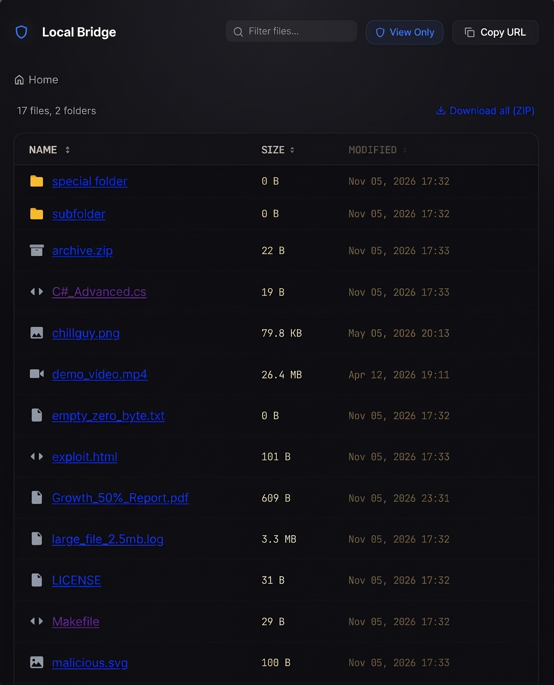
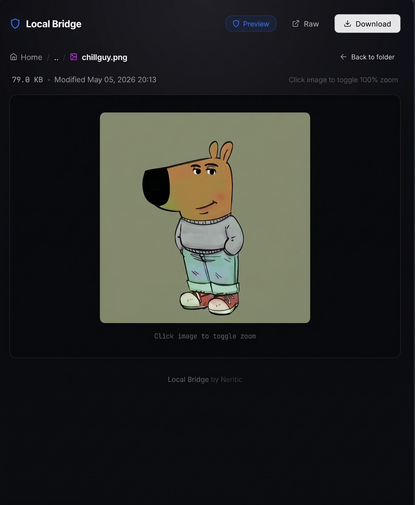

# LocalBridge Core

> **Instant, zero-config local folder sharing over Cloudflare edge tunnels with Quick-PIN security.**

[](https://github.com/AjayShukla007/localbridge/releases)
[](https://localbridge.theneritic.com/terms)
[]()
[]()

LocalBridge Core is a lightweight, zero-dependency command-line utility that lets you securely share any local directory across the internet in under two seconds.

No router configuration. No port forwarding. No accounts, emails, or API tokens required.

```bash
$ lb . --pin

╔═══════════════════════════════════════════════════════════╗
║              Local Bridge - File Server                  ║
╠═══════════════════════════════════════════════════════════╣
║  Serving:  /Users/ajay/projects/frontend/dist             ║
║  Password: [✓] PIN: 4364                                  ║
║  Mode:     Read-Only (Safe)                               ║
║  Local:    http://localhost:8080                          ║
╚═══════════════════════════════════════════════════════════╝

[*] Starting Cloudflare tunnel...
[✓] Public URL ready: https://ocean-breeze-california.trycloudflare.com
[✓] 1-Click URL copied to clipboard: https://ocean-breeze-california.trycloudflare.com?pin=4364
```

---

## Install

### Package Managers

- **macOS & Linux (Homebrew)**:
  ```bash
  brew tap AjayShukla007/localbridge
  brew install localbridge
  ```
  Installs both `localbridge` and the `lb` alias.

- **Windows (Scoop)** *(Recommended)*:
  ```powershell
  # Via bucket
  scoop bucket add localbridge https://github.com/AjayShukla007/scoop-bucket
  scoop install localbridge

  # Or directly from the manifest URL
  scoop install https://raw.githubusercontent.com/AjayShukla007/localbridge/main/manifests/scoop/localbridge.json
  ```
  Installs both `localbridge` and the `lb` alias.

- **Windows (WinGet)**:
  ```powershell
  winget install TheNeritic.LocalBridge
  ```
  *Pending approval in `microsoft/winget-pkgs`. Installs `localbridge` only (WinGet portable packages support one command alias; use Scoop if you also want `lb`).*

### Standalone Binaries

Download standalone executables directly from [GitHub Releases](https://github.com/AjayShukla007/localbridge/releases/latest):

| Operating System | Architecture | Binary Asset |
| :--- | :--- | :--- |
| **macOS** | Apple Silicon (M1/M2/M3/M4) | `localbridge-core-darwin-arm64` |
| **macOS** | Intel (x86_64) | `localbridge-core-darwin-amd64` |
| **Windows** | 64-bit (x64) | `localbridge-core-windows-amd64.exe` |
| **Windows** | ARM64 (Surface / Copilot+) | `localbridge-core-windows-arm64.exe` |
| **Linux** | 64-bit (x86_64) | `localbridge-core-linux-amd64` |
| **Linux** | ARM64 (Raspberry Pi 4/5) | `localbridge-core-linux-arm64` |

> **Windows SmartScreen:** Direct downloads of unsigned binaries may trigger a Microsoft Defender SmartScreen prompt on first run. Select **More info** -> **Run anyway** to execute the binary, or verify the download SHA-256 hash against `checksums-core.txt`.

---

## 30-Second Quickstart

```bash
# 1. Instant share with automatic Quick-PIN (zero prompts)
lb . --pin

# 2. Interactive share (prompts to choose Quick-PIN [Default] or Public)
lb .

# 3. Share a specific folder
lb ./my-project --pin

# 4. Share publicly with no PIN protection
lb ./dist --public

# 5. Check system diagnostics and tunnel connectivity
lb doctor
```

---

## The Recipient Experience

When you share an `lb .` link, the recipient opens a secure, responsive web explorer in their desktop or mobile browser.

### Interactive Folder Explorer
Recipients can navigate subdirectories, inspect file sizes and modification dates, and download individual files or the entire folder as a single `.zip` archive:



### Inline Media & Document Previews
LocalBridge automatically renders live previews directly in the browser without requiring external viewers:
- **Images**: PNG, JPEG, SVG, WebP, GIF with full-resolution zoom.
- **Documents & Code**: Markdown (GFM), syntax-highlighted source code, and PDF documents.
- **Video & Audio**: Hardware-accelerated streaming for MP4, WebM, and MP3 files.



---

## Why LocalBridge Core Exists

Sharing local directories across the internet should be as simple as running a command in your terminal. Developers should not have to configure router port forwarding, configure dynamic DNS, or upload private files to third-party cloud storage simply to demo a frontend build, share logs with a colleague, or test a site on a mobile device.

Operating global edge tunnels and routing infrastructure requires ongoing engineering resources and bandwidth. LocalBridge Core is provided as an **unmetered, zero-telemetry community utility** for interactive foreground sharing.

The project is sustainably funded by our **one-time perpetual commercial licenses**:
- **Personal License ($14.99)**: Activates up to 3 machines for an individual developer.
- **Team License ($28.99)**: Activates up to 10 machines across engineering teams, agencies, or persistent staging servers.

Commercial licenses provide background daemon execution (`--bg`), branded custom domains (`--domain`), persistent share recovery (`lb start`), and saved share profiles (`lb profile`). This sustainable model allows us to keep Core free, fast, and maintained forever without advertisements, venture capital pressure, or user tracking.

---

## Core vs. Licensed Commercial Edition

LocalBridge Core is 100% free for individual and commercial foreground use. When you require persistent background services, custom branding, or team automation, upgrade seamlessly:

| Capability | LocalBridge Core (Free) | LocalBridge Licensed |
| :--- | :---: | :---: |
| **Instant Cloudflare Edge Tunnel** | ✅ Unlimited | ✅ Unlimited |
| **Quick-PIN Security (4-digit)** | ✅ Yes | ✅ Yes |
| **Public Unauthenticated Mode (`--public`)** | ✅ Yes | ✅ Yes |
| **Concurrent Foreground Shares** | ✅ Unlimited | ✅ Unlimited |
| **Interactive Terminal UI & QR Code** | ✅ Yes | ✅ Yes |
| **Folder ZIP Downloads** | 1 GB Quota per download | **Unlimited** |
| **Background Daemon Execution (`--bg`)** | — | ✅ Supported |
| **Branded Custom Domains (`--domain`)** | — | ✅ Supported |
| **Custom Alpha Passwords (`--password`)** | — | ✅ Supported |
| **Saved Share Profiles (`lb profile`)** | — | ✅ Supported |
| **Persistent Shares Lifecycle (`lb start`/`stop`)** | — | ✅ Supported |
| **Local Web Management Dashboard (`lb ui`)** | — | ✅ Supported |
| **Pricing** | **Free Forever ($0)** | **[$14.99 Personal](https://localbridge.theneritic.com/#pricing) / [$28.99 Team](https://localbridge.theneritic.com/#pricing)** |

### Upgrading to the Licensed Edition
Already running LocalBridge Core? When you purchase a license, unlock all commercial features immediately without re-installing:

```bash
lb activate YOUR_LICENSE_KEY
```

Your license is verified securely with our edge API, preserving your existing configuration, shell aliases, and active terminal sessions with zero downtime.

---

## Security & Architecture

- **No Open Ports**: Uses outbound Cloudflare tunnels over QUIC/HTTP2. Works reliably behind NAT, corporate firewalls, and VPNs.
- **Zero Account Tracking**: Core does not collect telemetry, email addresses, or user identities.
- **Local Host PIN Validation**: Quick-PINs are cryptographically generated and verified locally on your machine. The Cloudflare edge never receives or stores your PIN.
- **Sandboxed File Serving**: Strict directory-jail enforcement prevents path traversal attacks (`../`).

---

## Bug Reports & Community Support

Found a bug or have a suggestion? Open an issue in our [GitHub Issue Tracker](https://github.com/AjayShukla007/localbridge/issues).

If LocalBridge Core saves you time, please star ⭐ the repository on GitHub to support our open developer mission.

---

## License

LocalBridge Core is distributed as free-to-use software by The Neritic. See [Terms of Service](https://localbridge.theneritic.com/terms) for details.
